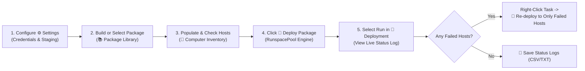
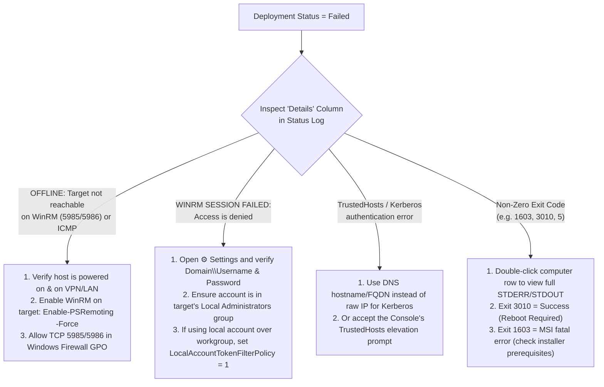

# 🚀 Remote Deployment Console — Administrator & Visual User Guide

Welcome to the **Remote Deployment Console** (`ps_deploy.ps1` / `ps_deploy.exe`) Administrator and Visual User Guide. This guide provides a complete visual walkthrough of the console layout, package creation and library management, Active Directory & manual computer inventory management, multi-threaded remote package deployment, re-deployment workflows, and end-to-end troubleshooting.

---

## 📑 Table of Contents
1. [Console Architecture & Visual Workspace Map](#1-console-architecture--visual-workspace-map)
2. [Initial Configuration & Settings (`⚙️ Settings`)](#2-initial-configuration--settings-️-settings)
3. [Navigating the Console & Customizing Your Layout](#3-navigating-the-console--customizing-your-layout)
4. [Package Library Management (Create, Save, Import, Export)](#4-package-library-management-create-save-import-export)
5. [Adding Computers to the Computer Inventory (Manual & PDQ-Style AD Sync)](#5-adding-computers-to-the-computer-inventory-manual--pdq-style-ad-sync)
6. [Deploying a Package & Managing Running / Historical Deployments](#6-deploying-a-package--managing-running--historical-deployments)
7. [Inspecting Live Status Logs & Multi-Step Output Details](#7-inspecting-live-status-logs--multi-step-output-details)
8. [Troubleshooting Guide & Remote Prerequisites Reference](#8-troubleshooting-guide--remote-prerequisites-reference)

---

## 1. Console Architecture & Visual Workspace Map

The Remote Deployment Console uses a dark-themed (Catppuccin Mocha), resizable 4-zone layout with persistent splitter positions and column filters.

### Visual Layout Map

```text
+----------------------------------------------------------------------------------------------------------+
| 🚀 Remote Deployment Console | Multi-step package deployment...   Auth: DOMAIN\Admin | Staging  [⚙️ Settings] |
+-------------------------------+--------------------------------------------------------------------------+
| 📚 PACKAGE LIBRARY            | 🎯 COMPUTER INVENTORY                   AD Sync: Auto (0d 4h 0m) | 2 OU(s)|
| [＋ New] [📁 Folder] [🗑 Delete]| Computer: [____________] [＋ Add] [🔄 Sync AD] [🔄 Probe] [☑ All/None] [✕] |
| +---------------------------+ | +--------+---------------+--------+------------+----------+------------+ |
| | 📁 General                | | | Deploy | Computer Name | Online | IP Address | Logon    | AD OU Path | |
| |   📦 Systeminfo Summary   | | | [All▾] | [Filter...  ] | [=Onl] | [Filter..] | [Filter] | [Filter..] | |
| | 📁 Maintenance            | | +--------+---------------+--------+------------+----------+------------+ |
| |   📦 GPUpdate & Reboot    | | |  [☑]   | NWCLW04857338 | Online | 161.55.x.x | CORP\jdoe| NMFS/...   | |
| | 📁 Bitlocker              | | |  [☑]   | NWCDW04421544 | Online | 161.55.x.x | Unknown  | NMFS/...   | |
| |   📦 Bitlocker-Status     | | +--------+---------------+--------+------------+----------+------------+ |
| | 📁 Software Installer     | | Checked / Imported: 2/306 (2 checked of 306 imported)  [🧹 Clear Filters]|
| |   📦 Install Chrome       | +--------------------------------------------------------------------------+
| |                           | | ═══════════════════════ [Horizontal GridSplitter] ══════════════════════ |
| |  (Right-Click TreeView    | +--------------------------------------------------------------------------+
| |   for Context Menu:       | | 🚀 DEPLOYMENT  [Active Package: Bitlocker-Status (1 step)]               |
| |   • Edit Package Steps... | |                [🧹 Clear History]            [🚀 Deploy Selected Package] |
| |   • New Folder...         | | Running Deployments & Deployment History (select a task to view logs):   |
| |   • Save Current Here     | | +-----------------------------------+--------+-----------------+-------+ |
| |   • Rename Selected...    | | | Deployment Task / Package         | Status | Target Progress | Steps | |
| |   • Import Package...     | | +-----------------------------------+--------+-----------------+-------+ |
| |   • Export Package...     | | | Systeminfo Summary (OS, Boot...)  | Failed | 2/2 (0 OK,2 Fail|   1   | |
| |   • Delete Selected)      | | | Bitlocker-Status                  | Success| 4/4 (4 OK,0 Fail|   1   | |
| +---------------------------+ +-----------------------------------+--------+-----------------+---------+ |
+-------------------------------+--------------------------------------------------------------------------+
| ═══════════════════════════════════════ [Full-Width Horizontal GridSplitter] ═══════════════════════════ |
+----------------------------------------------------------------------------------------------------------+
| [☐] Continue on step failure   [🧹 Clear Log Filters] [🗑 Delete Row] [🧹 Clear Status] [💾 Save Status Logs] |
|                                                                                        [⏹ Stop Deployment] |
| +---------------+------------------+--------------------+--------+-------------------+-----------------+ |
| | Computer Name | Package          | Current / Last Step| Status | Start / End Time  | Details         | |
| +---------------+------------------+--------------------+--------+-------------------+-----------------+ |
| | NWCDW04421544 | Systeminfo Summ..| 1. Systeminfo...   | Failed | 2026-10-25 17:43  | WINRM SESSION...| |
| | NWCLW04780579 | Systeminfo Summ..| 1. Systeminfo...   | Failed | 2026-10-25 17:43  | OFFLINE: Targ...| |
| +---------------+------------------+--------------------+--------+-------------------+-----------------+ |
| Ready. Select a deployment task above to view its computer status rows.                                  |
+----------------------------------------------------------------------------------------------------------+
```

### End-to-End Operational Flow



---

## 2. Initial Configuration & Settings (`⚙️ Settings`)

Before deploying packages to remote endpoints, click the **`⚙️ Settings`** button in the top-right corner of the header bar.

| Setting Field | Description & Best Practice |
| :--- | :--- |
| **Use Current Windows Logon Session** | Uses your currently logged-in Windows/AD Kerberos token. Best when launching `ps_deploy.exe` directly as a Domain Admin or Workstation Admin. |
| **Domain / Workstation** | Specify the Active Directory domain (e.g., `NMFS.LOCAL` or `CORP`) or leave blank for local account authentication (`.\Administrator`). |
| **Admin Username & Password** | Encrypted on disk using Windows **DPAPI (`ProtectedData` CurrentUser scope)** inside `settings.json`. Credentials can only be decrypted by the same Windows user on the same machine. |
| **Local Config & Library Directory** | Folder where `settings.json`, `package_library.json`, `computers_inventory.json`, `ad_sync_config.json`, and `status_state.json` are stored. |
| **Remote Staging Directory** | Temporary folder created on target computers during file/installer copy steps (default: `C:\Temp\PSDeploy`). Automatically cleaned up after each step completes. |
| **Max Concurrent Targets** | Number of simultaneous remote computers processed in parallel via the background `RunspacePool` (`1` to `8`, default `8`). |

---

## 3. Navigating the Console & Customizing Your Layout

1. **Resizable Panels**:
   - Drag the **vertical splitter** between **📚 Package Library** and the right workspace to widen or narrow the library tree.
   - Drag the **upper horizontal splitter** between **🎯 Computer Inventory** and **🚀 Deployment** to allocate more vertical space to either table.
   - Drag the **lower horizontal splitter** above the **Status Log** bar to expand or collapse diagnostic output space.
   - All splitter proportions and window dimensions are **automatically saved on exit** (`ui_layout.json`) and restored on launch.
2. **Excel-Style Column Sorting & Filtering**:
   - Every column in **🎯 Computer Inventory** and the **Status Log** features:
     - **Click Header Title**: Toggle Ascending / Descending sort (`⇅`).
     - **Inline Filter Box**: Type any substring (or `=Online`, `!=Offline`) to filter rows in real time.
     - **Dropdown Menu (`▾`)**: Sort Ascending, Sort Descending, Filter by specific distinct values in that column, or Clear Column Filter.
   - Click **`🧹 Clear Filters`** (in Computer Inventory) or **`🧹 Clear Log Filters`** (in the Status Log) at any time to reset all active column filters.

---

## 4. Package Library Management (Create, Save, Import, Export)

The **📚 PACKAGE LIBRARY** panel on the left organizes all deployment packages into folders (e.g., `General`, `Maintenance`, `Bitlocker`, `Software Installer`).

### 4.1 Toolbar & Right-Click Context Menu Actions

```text
+------------------------------------------+
| 📚 PACKAGE LIBRARY                       |
| [＋ New]  [📁 Folder]  [🗑 Delete]        |
+------------------------------------------+
| 📁 General                               |
|   📦 Systeminfo Summary  <-- Right-Click |
|     +------------------------------------+---+
|     | 📦 Edit Package Steps...         Enter |
|     | 📁 New Folder...                Folder |
|     | 💾 Save Current Package Here    Ctrl+S |
|     | ✏  Rename Selected...               F2 |
|     | -------------------------------------- |
|     | 📥 Import Package...              JSON |
|     | 📤 Export Package...              JSON |
|     | -------------------------------------- |
|     | 🗑 Delete Selected                 Del |
|     +----------------------------------------+
```

### 4.2 Creating a New Package (`＋ New` or Double-Click)
1. Click **`＋ New`** in the Package Library toolbar (or **double-click** / **right-click -> `📦 Edit Package Steps...`** on any existing package).
2. The **📦 Package Steps Builder** modal window opens:
   - **Package Name**: Enter a descriptive name (e.g., `Deploy 7-Zip 24.08 Silent`).
   - **Library Folder**: Select an existing folder from the dropdown or type a new folder name.
3. Add one or more ordered steps using the modal toolbar:
   - **`＋ Add Step`**: Opens the **Step Editor** where you can choose the step type:
     - **`PowerShell`**: Runs an inline PowerShell script block on the remote host via WinRM (`Invoke-Command`).
     - **`Batch`**: Stages and executes a `.bat`/`.cmd` script via `cmd.exe /c` on the remote host.
     - **`Executable / Installer`**: Copies a local `.exe`, `.msi`, `.msp`, `.bat`, or `.ps1` file (and optionally its entire parent folder when **Include entire folder** is checked) to the remote staging directory (`C:\Temp\PSDeploy`) and executes it.
       - Checking **Silent Install** automatically appends silent flags (`/qn /norestart` for `.msi`, `/S` for `.exe` if no custom parameters are provided).
     - **`Pause / Wait`**: Pauses execution on that target for the specified number of seconds between steps.
   - **`📚 Canned Scripts`**: Opens the built-in **28-Script Windows SysAdmin & IT Troubleshooting Catalog** across 6 categories:
     - *System & Hardware Inventory* (Systeminfo, Uptime, Disk Space, Top CPU/RAM Processes, Installed Software)
     - *Network & Connectivity Diagnostics* (IP/DNS Config, Flush DNS & Register, Listening Ports, SMB Shares, Ping/WinRM Check)
     - *Active Directory, Group Policy & Users* (GPUpdate Force, RSoP Summary, Logged-On Users, Local Administrators Audit)
     - *Windows Update, Services & Event Logs* (Installed Hotfixes, Pending Reboot Check, Auto-Start Stopped Services, Critical/Error Events, Reset Windows Update)
     - *Security, Defender & OS Repair* (BitLocker Status, Defender Status & Quick Scan, Firewall Profile Status, DISM & SFC Health Check, Expiring SSL Certificates)
     - *Disk Cleanup & Maintenance* (Clear Temp Cache, Clear Print Spooler, Schedule Controlled Reboot, Cancel Pending Reboot)
   - **`✏ Edit` / `🗑 Remove` / `▲ Up` / `▼ Down`**: Modify or reorder steps in the execution sequence.

### 4.3 Saving a Package
- Inside the **Package Steps Builder** modal, click **`💾 Save to Library`** in the bottom-right corner to save the package into the selected folder.
- You can also right-click any folder in **📚 Package Library** and click **`💾 Save Current Package Here`** (`Ctrl+S`).
- All packages are persisted automatically in `package_library.json` and as individual JSON files under the `Packages\` directory.

### 4.4 Importing & Exporting Packages (Right-Click Context Menu)
- **To Export a Package (`📤 Export Package...`)**:
  1. In **📚 Package Library**, **right-click** the package you want to share or back up.
  2. Click **`📤 Export Package...`**.
  3. Choose a destination `.json` file path and click **Save**. The exported JSON contains the package name, folder name, and all ordered step definitions.
- **To Import a Package (`📥 Import Package...`)**:
  1. **Right-click** anywhere in **📚 Package Library** (if you right-click a specific folder, the imported package can be placed directly into that folder).
  2. Click **`📥 Import Package...`**.
  3. Select one or more exported `.json` package files. The package is added to the library tree and immediately loaded as the active package.

---

## 5. Adding Computers to the Computer Inventory (Manual & PDQ-Style AD Sync)

The **🎯 COMPUTER INVENTORY** panel manages your target endpoints and displays live reachability and Active Directory metadata:
- **Columns**: `Deploy` (checkbox), `Computer Name`, `Online Status`, `IP Address`, `Current Logon User`, `AD OU Path`, and `AD Last Logon`.
- **Important Behavior**: Newly added or synced computers are **not auto-checked** by default, preventing accidental mass deployments. You explicitly check the hosts you want to deploy to.

### 5.1 Method 1 — Manual Entry (`＋ Add`)
1. In the `Computer:` text box, type a single hostname (`NWCLW04857338`), FQDN (`pc01.domain.local`), IP address, or a **comma/space/semicolon-separated list** of hosts.
2. Click **`＋ Add`** (or press `Enter`).
3. The console adds the computer(s) with `AD OU Path = Manual / Workgroup` and automatically launches a background probe to resolve **Online Status**, **IP Address**, and **Current Logon User**.

### 5.2 Method 2 — PDQ-Style Active Directory Sync (`🔄 Sync AD`)
Click **`🔄 Sync AD`** in the Computer Inventory toolbar to open the **Active Directory Sync** configuration dialog:

```text
+-----------------------------------------------------------------------------------+
| Active Directory Sync                                                             |
|  [☑] Auto Sync Enabled                                                            |
|  Sync Every:   [ 0 ] d   [ 4 ] h   [ 0 ] m                                        |
|  Delete Mode:  [ Full Sync (delete all computers not part of sync)            ▾ ] |
|  [☐] Sync Disabled Computers                                                      |
|                                                                                   |
|  Containers to Sync:                                          [Include Container] |
|  +----------+-----------------------------------------------+ [Exclude Container] |
|  | Included | Container                                     | [      Edit       ] |
|  +----------+-----------------------------------------------+ [    Sync Now     ] |
|  |    ✔     | 📁 NMFS.LOCAL/_NMFS/NWC/Computers/Servers     |                     |
|  |    ✔     | 📁 NMFS.LOCAL/_NMFS/NWC/Computers/Workstations| [     Delete      ] |
|  +----------+-----------------------------------------------+                     |
|  Last Sync: 10/25/2026 8:15:15 AM   |   Last Sync Status: Success                 |
+-----------------------------------------------------------------------------------+
```

1. **Selecting Organizational Units (`Include Container`)**:
   - Click **`Include Container`** to browse your Active Directory forest/domain hierarchy in a tree view.
   - **Parent/Child OU Selection**: Checking a **Parent OU** automatically selects all of its **Child OUs**. You can then **uncheck individual Child OUs** if you want to exclude specific sub-containers without unchecking the parent.
2. **Delete Mode Options**:
   - **Import Only (never delete existing computers)**: Adds new AD computers from the selected OUs without removing any existing hosts.
   - **Mixed Sync (delete AD computers not in sync, keep Manual hosts)**: Removes computers that moved out of your synced OUs or were deleted from AD, while preserving manually added workgroup/IP hosts.
   - **Full Sync (delete all computers not part of sync)**: Mirrors the selected AD OUs exactly.
3. **Automatic Scheduled Sync**:
   - Enable **`Auto Sync Enabled`** and set the interval in **Days (`d`) / Hours (`h`) / Minutes (`m`)** (e.g., `0d 4h 0m`).
   - The top-right badge in **🎯 Computer Inventory** displays the live sync schedule, OU count, and last sync timestamp.
4. **Probing Live Host Status (`🔄 Probe`)**:
   - Click **`🔄 Probe`** in the Computer Inventory toolbar (or right-click a single computer and select **`Probe Selected Computer Status (F5)`**) to refresh ICMP/WinRM reachability, IP address, and logged-on user across your inventory using background runspaces.

---

## 6. Deploying a Package & Managing Running / Historical Deployments

### 6.1 Starting a Deployment
1. **Select a Package**: Click a package in **📚 PACKAGE LIBRARY** on the left. Verify the green badge in the **🚀 DEPLOYMENT** header shows `Active Package: <Package Name> (<N> steps)`.
2. **Check Target Computers**: In **🎯 COMPUTER INVENTORY**, check the **`Deploy`** box next to one or more target computers:
   - Tip: Type `=Online` in the **Online Status** filter box and click **`☑ All / None`** to check only online computers.
3. **Launch Deployment**: Click **`🚀 Deploy Selected Package`** in the **🚀 DEPLOYMENT** panel header (or right-click the package in **📚 PACKAGE LIBRARY** and choose **`🚀 Deploy This Package Now`**).
   - **Preflight Checks**:
     - If admin credentials are not configured and **Use Current Windows Logon Session** is unchecked, the console prompts you to open **`⚙️ Settings`**.
     - If any target requires **WinRM `TrustedHosts`** configuration (e.g., IP address or workgroup/local credentials), the console offers an elevated one-click prompt to add them.
   - **Concurrent Background Execution**: You can launch multiple package deployments simultaneously; each run appears as its own row in **Running Deployments & Deployment History**.

### 6.2 Understanding Deployment Task Status
Each row in **Running Deployments & Deployment History** tracks a deployment batch across all targeted computers:

| Task Status | Color | Meaning |
| :--- | :--- | :--- |
| **`Running`** | Yellow (`#F9E2AF`) | One or more target computers are actively executing steps in the background `RunspacePool`. |
| **`Success`** | Green (`#A6E3A1`) | Every target computer in the batch completed all steps with `0` failures (`N/N (N OK, 0 Fail)`). |
| **`Failed`** | Red (`#F38BA8`) | One or more target computers in the batch failed a step, failed WinRM authentication, or were offline (`N/N (X OK, Y Fail)`). |
| **`Stopped`** | Amber (`#F9E2AF`) | Deployment was cancelled by clicking **`⏹ Stop Deployment`** (with `0` prior failures). |

### 6.3 Right-Clicking a Deployment Task to Re-Deploy (`Failed Hosts` vs. `All Hosts`)

Right-clicking any row in the **Running Deployments & Deployment History** table opens the deployment task context menu:

```text
+------------------------------------------------------------------------------------+
| 🚀 DEPLOYMENT   [Active Package: Systeminfo Summary (1 step)]                      |
+---------------------------------------------------+--------+-----------------------+
| Deployment Task / Package                         | Status | Target Progress       |
+---------------------------------------------------+--------+-----------------------+
| Systeminfo Summary (OS, Boot Time, Domain...)     | Failed | 2/2 (0 OK, 2 Fail)    |
+---------------------------------------------------+--------+-----------------------+
          |
          +--> Right-Click Context Menu:
               +-------------------------------------------------------+
               | 🔄  Re-deploy to Only Failed Hosts                    |
               | 🚀  Re-deploy to All Hosts                            |
               | ----------------------------------------------------- |
               | 👁  Deselect Deployment Task (Hide Status Log)        |
               | 🗑  Remove Selected Deployment History Entry          |
               +-------------------------------------------------------+
```

- **`🔄 Re-deploy to Only Failed Hosts`**:
  - Automatically filters the deployment task's target list to **only the hosts whose status was not `Success`** (e.g., `Failed`, `Stopped`, or `Offline`) and immediately launches a new deployment run of that exact package against those failed hosts.
  - Automatically disabled if all hosts in that deployment run succeeded (`0 Fail`).
- **`🚀 Re-deploy to All Hosts`**:
  - Re-runs that exact package against **all target computers** that were part of the selected deployment task, even if a different package is currently selected in the Package Library or even after restarting the application.
- **`👁 Deselect Deployment Task (Hide Status Log)`** *(or press `Esc`)*:
  - Clears the selection in the Deployment panel and hides the per-computer rows in the lower Status Log.
- **`🗑 Remove Selected Deployment History Entry`**:
  - Removes the selected completed deployment run and its associated computer rows from history. (Use **`🧹 Clear History`** in the Deployment header bar to clear all completed runs at once.)

---

## 7. Inspecting Live Status Logs & Multi-Step Output Details

The lower **Status Log** table displays per-computer execution status **only when a deployment task is selected** in the **🚀 DEPLOYMENT** panel above (keeping the console clean when no task is selected).

### 7.1 Viewing Detailed Step-by-Step Output
- **Double-click** any computer row in the Status Log (or **right-click -> `🔍 View Detailed Multi-Step Logs...`**) to open the **Deployment Step Details** modal:
  - **Upper Grid**: Shows every step (`Step #`, `Step Name`, `Type`, `Status`, `Duration`, `Timestamp`, and `Summary`).
  - **Lower Console**: Displays the complete `STDOUT`, `STDERR`, exit codes, or WinRM diagnostic hints for the selected step, or click **`Show Combined Full Log (All Steps)`** to inspect the entire transcript.
  - Click **`📋 Copy Output to Clipboard`** to copy the full transcript for ticketing or escalation.

### 7.2 Exporting Status Logs
- Click **`💾 Save Status Logs`** above the Status Log table to export all deployment records to a structured **`.csv`** or **`.txt`** report in your `Logs\` folder.

---

## 8. Troubleshooting Guide & Remote Prerequisites Reference

### 8.1 Common Deployment Errors & Remedies



| Symptom / Error Message | Root Cause | Resolution |
| :--- | :--- | :--- |
| **`OFFLINE: Target not reachable on WinRM ports (5985/5986) or ICMP ping.`** | Target is powered off, disconnected from VPN/network, or Windows Firewall blocks both ICMP and TCP `5985`/`5986`. | 1. Verify the computer is online.<br>2. Ensure the **Windows Remote Management (WS-Management)** (`WinRM`) service is Running.<br>3. Configure GPO: *Computer Configuration -> Policies -> Windows Settings -> Security Settings -> System Services -> Windows Remote Management (WS-Management)* = **Automatic**, and allow **Windows Remote Management (HTTP-In)** in Windows Defender Firewall. |
| **`WINRM SESSION FAILED ... Access is denied`** | Configured credentials lack local administrator rights on the target, or UAC remote restrictions blocked a non-domain local admin account. | 1. Click **`⚙️ Settings`** and verify `Domain\Username` and password.<br>2. Confirm the account belongs to the target's local `Administrators` group.<br>3. For workgroup / local admin accounts, set `HKLM:\SOFTWARE\Microsoft\Windows\CurrentVersion\Policies\System\LocalAccountTokenFilterPolicy` = `1` (DWORD). |
| **`The WinRM client cannot process the request. Default authentication may be used with an IP address under the following conditions...`** | Deploying to an IP address or non-domain host without adding it to `WSMan:\localhost\Client\TrustedHosts`. | Click **Yes** when the console displays the **TrustedHosts Preflight** prompt before deployment, or deploy using the computer's Active Directory DNS hostname/FQDN. |
| **Computer Inventory shows `Unknown (Access/Firewall)` under Current Logon User** | Target responded to ping/WinRM port check, but WMI/CIM (`Win32_ComputerSystem`) or `quser` query was blocked by firewall or credentials. | Configure your Domain Admin credentials in **`⚙️ Settings`** and click **`🔄 Probe`** to re-query using authenticated CIM/WinRM sessions. |
| **Status Log at the bottom of the screen is blank** | By design, the Status Log filters rows to the currently selected deployment task in **🚀 DEPLOYMENT**. | Click any row in the **Running Deployments & Deployment History** table in the **🚀 DEPLOYMENT** panel to display its target computer status rows. |

### 8.2 Remote Prerequisites for Built-In Canned Scripts
All 28 scripts in the **📚 Canned Scripts Library** are self-contained and require **no third-party modules** on remote endpoints. Each script header documents its exact remote requirements:
- **Core Requirement (All Scripts)**: `WinRM` (`WSMan`) service running, TCP `5985`/`5986` reachable, and Local Administrator permissions on the target computer.
- **Service-Specific Canned Scripts**:
  - *Disk Space, Uptime, Processes, Services, Installed Software, Local Admins*: Require the **Windows Management Instrumentation (`Winmgmt`)** service running on the target.
  - *Active Directory & GPO Scripts (`gpupdate /force`, `gpresult /r`)*: Require the target computer to be domain-joined with line-of-sight to a Domain Controller, or run with `-UseCurrentCred` (Kerberos) if network policy queries user GPOs.
  - *Windows Defender Status & Quick Scan*: Requires the **Microsoft Defender Antivirus Service (`WinDefend`)** running (automatically reports a clean informational notice if a third-party EDR replaces Defender).
  - *Clear Print Spooler Queue*: Interacts with the **Print Spooler (`Spooler`)** service.
  - *Expiring SSL/TLS Certificates*: Requires the **Cryptographic Services (`CryptSvc`)** service running.
