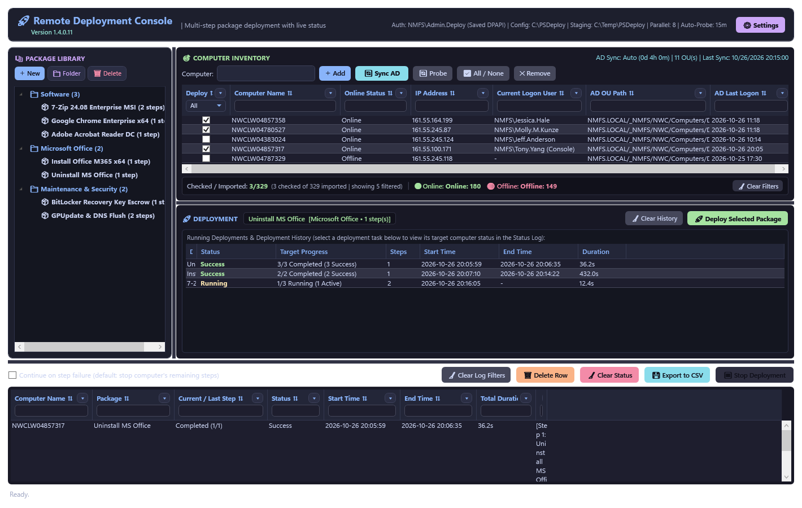
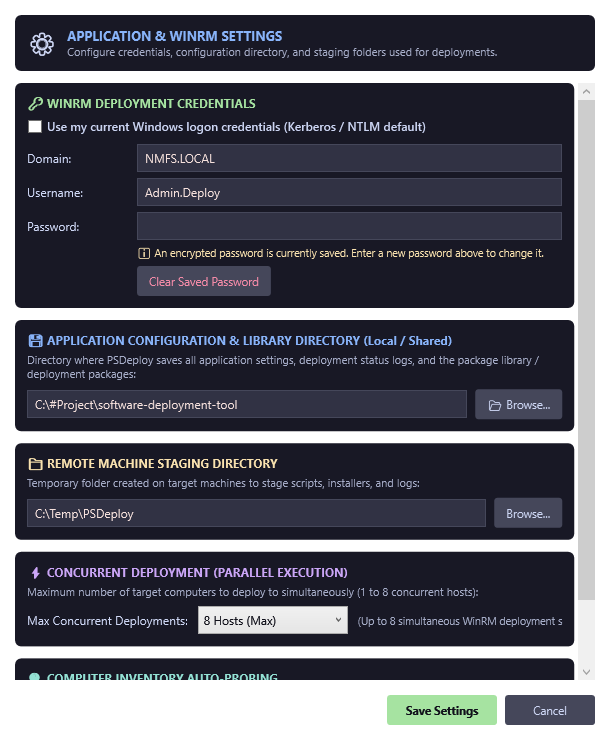
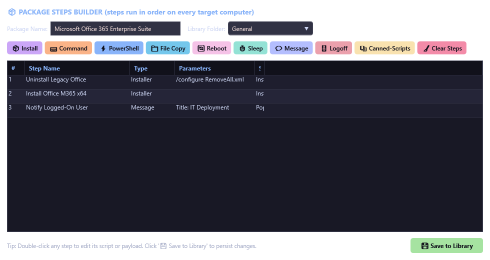
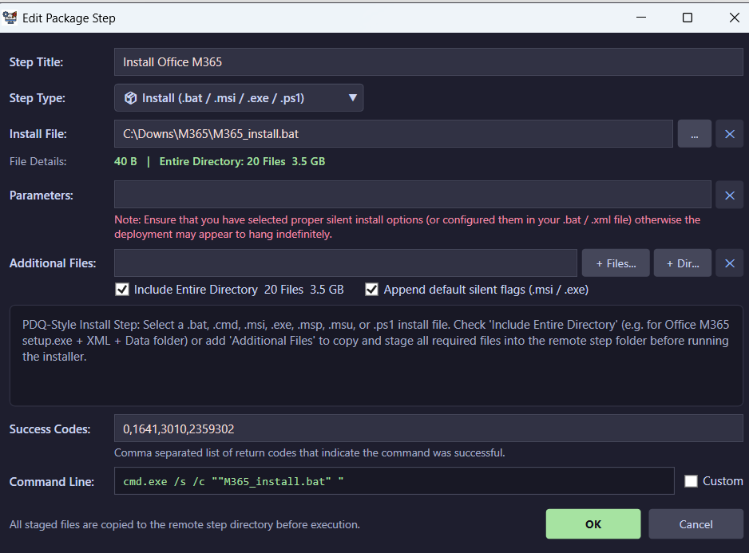
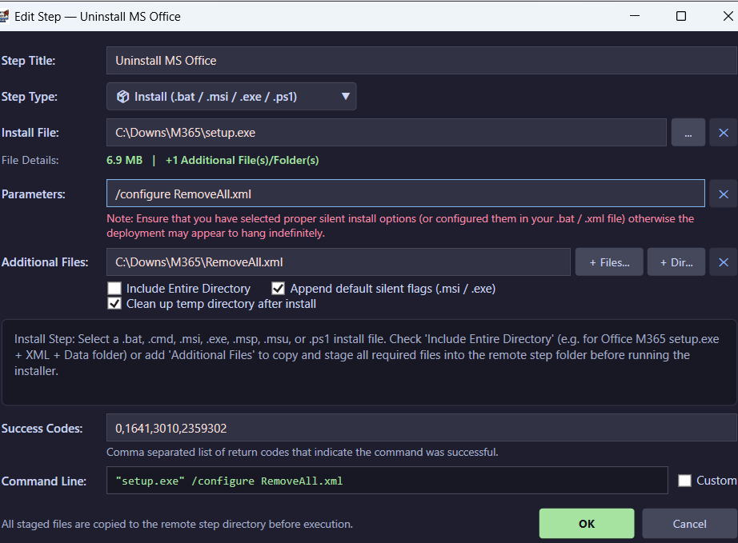
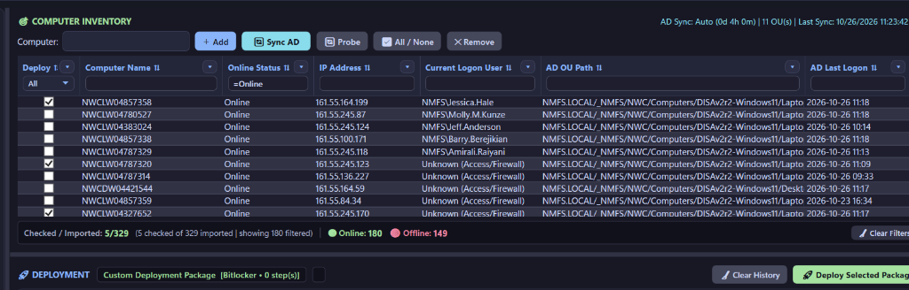
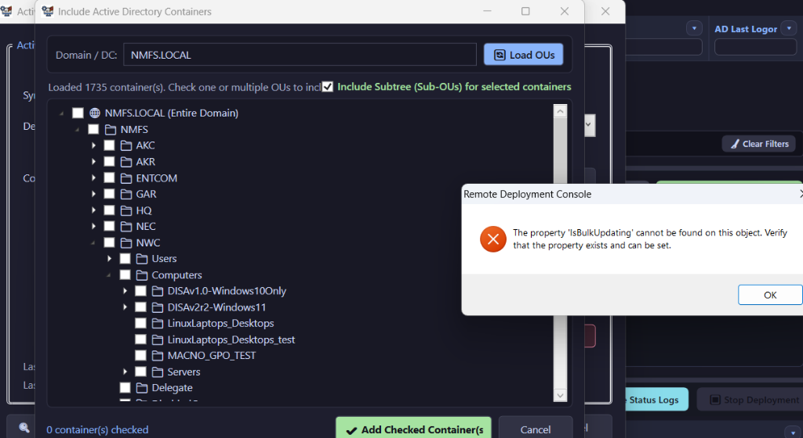
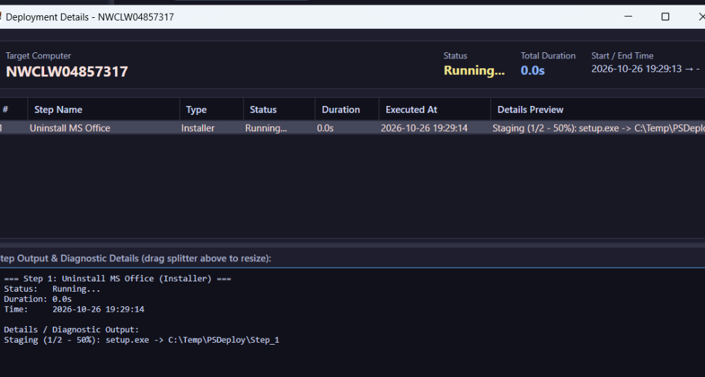

# 🚀 Remote Deployment Console (PSDeploy v1.4.0.16) — Administrator & Visual User Guide

> **HTML Visual Guide Available:** Open **[Admin_Guide.html](./Admin_Guide.html)** in any web browser for the interactive, dark-themed HTML version of this guide with embedded click-to-zoom screenshots.

---

## 1. Application Overview & Workspace Layout

**Remote Deployment Console (ps_deploy.exe / ps_deploy.ps1 — Version 1.4.0.16)** is a 64-bit Windows Presentation Foundation (WPF) administration console for Active Directory computer inventory synchronization, background batched host probing, and parallel multi-step software deployment.

---

## 2. Top Header Bar, Version Subtitle & Global Settings (⚙️ Settings)

Directly beneath the **🚀 Remote Deployment Console** title in the top header bar, the application displays **Version 1.4.0.16** (automatically synchronized during build by `build_exe.ps1`).

Click **⚙️ Settings** in the top-right corner to configure:
- **🔑 WinRM Deployment Credentials:** Use current Windows logon credentials or save a dedicated **Domain**, **Username**, and **DPAPI-encrypted Password** (used automatically for both remote deployments and local Session 0 SYSTEM elevation).
- **💾 Application Configuration & Library Directory:** Local or shared folder storing settings.json, package_library.json, `ad_sync_config.json`, and layout_state.json.
- **📁 Remote Machine Staging Directory:** Default C:\Temp\PSDeploy.
- **⚡ Concurrent Deployment:** Parallel execution across 1 to 8 hosts simultaneously.
- **🔍 Computer Inventory Auto-Probing:** Automatic background probing on startup and every 5, 10, 15, 30, or 60 minutes.

---

## 3. Package Steps Builder & Installer Configuration

Double-click any package in the **Package Library** (or click **+ New**) to open the **Package Steps Builder** modal window:

### Configuring Full-Directory .bat / .exe / .msi Installers (e.g., Microsoft Office M365 Install)
Check **☑️ Include Entire Directory** when your installer requires all companion files and subfolders (such as M365_install.bat + NWC_M365_Config.xml + Office\Data cabinet files):

### Configuring Targeted Companion Files & Temp Cleanup (e.g., Uninstall MS Office via RemoveAll.xml)
Use **Additional Files** (+ Files... / + Dir...) to stage specific companion files (such as RemoveAll.xml alongside setup.exe) and check **☑️ Clean up temp directory after install** to remove staged files automatically once execution completes. Office Click-to-Run exit code **17003** is recognized automatically as a valid success code (`0,1641,3010,2359302,17003`):

---

## 4. Computer Inventory, Active Directory Sync & Background Probing

The **Computer Inventory** panel persists all synced and manually added computers across restarts, shows live **🟢 Online** and **🔴 Offline** host counts in the status bar, and resolves the active **Current Logon User** using a 4-tier fallback (WinRM CIM -> DCOM -> SMB quser -> Remote Registry LogonUI):

Click **🔄 Sync AD** -> **+ Include OUs...** to browse and select Active Directory Organizational Units (OUs):

---

## 5. Live Deployment Monitoring & Silent File Staging Details

Double-click any computer row in the bottom **Status Log** to inspect real-time file staging progress and command output in the **Deployment Details** modal window, or click **💾 Export to CSV** to export the deployment status report:

